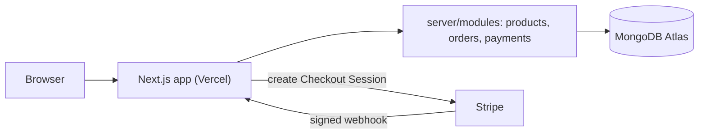
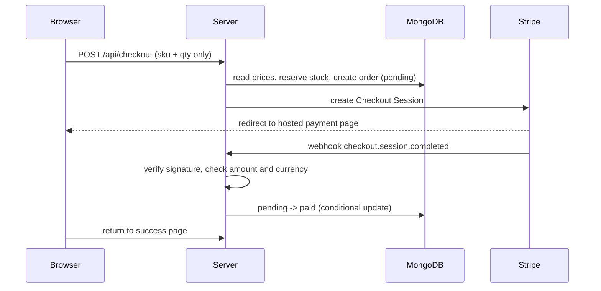

# Northline

A full-stack e-commerce store for a fictional footwear brand, built as a portfolio project. It covers the whole path from catalog to paid order: product pages, cart, Stripe Checkout, a verified webhook, customer accounts, and a role-protected admin panel.

**Live demo:** <https://northline-store-ai.vercel.app>
**Payments run in Stripe test mode.** Use card `4242 4242 4242 4242`, any future expiry date and any CVC. No real money is charged.


> Northline is a fictional brand. It has no connection to any real company, and the product images are illustrative.

## Screenshots

| Catalog | Product page |
|---|---|
|  |  |

| Cart | Admin orders |
|---|---|
|  |  |

## Features

**Storefront**
- Home page with an animated topographic route map (SVG and Framer Motion; it respects the reduced-motion setting)
- Product catalog with category filter and product pages (size selection, stock-aware, ISR)
- Cart stored in `localStorage`, validated with Zod when read back
- Responsive layout with a mobile menu, loading skeletons and branded 404 / error pages
- SEO at the markup level: per-page metadata, OpenGraph image, canonical URLs, JSON-LD `Product` schema, `sitemap.xml` and `robots.txt`

**Checkout and payments**
- Stripe Checkout (hosted page), guest checkout and signed-in checkout
- Server-side pricing and a verified, idempotent webhook (details below)

**Accounts**
- Email and password sign-up and sign-in with Better Auth
- Order history for signed-in customers

**Admin panel** (`/admin`, role-protected)
- Overview with revenue and order counts
- Orders table with status filter, "mark shipped" and cancel for unpaid orders
- Product management: create, enable / disable, delete

## Tech stack

| Area | Choice |
|---|---|
| Framework | Next.js (App Router), React, TypeScript |
| Styling | Tailwind CSS, Framer Motion |
| Database | MongoDB Atlas with Mongoose |
| Auth | Better Auth (email and password) with the MongoDB adapter |
| Payments | Stripe Checkout and webhooks |
| Validation | Zod |
| Tests | Vitest |
| Hosting | Vercel |

## Architecture

The app is one Next.js project. Route handlers and pages stay thin and call services in `server/modules`.



```
app/                  routes, pages, route handlers (thin)
  (shop)/             storefront, cart, account, login
  (admin)/admin/      admin panel
  api/                checkout, Stripe webhook, auth
components/           UI (shop, cart, auth)
server/
  lib/                db connection, auth, Stripe client, rate limiter, role guard
  modules/
    products/         model, schema, service, admin operations
    orders/           model, service, status transitions
    payments/         checkout session, webhook handler
tests/                unit tests
scripts/              seed data, make-admin
```

## How a payment works



Decisions behind it:

- **The client never sends prices.** The browser sends only `sku` and quantity. The server reads names and prices from the database and calculates the total. Prices are stored as integer cents.
- **Stock is reserved atomically.** Reserving stock and creating the pending order happen in one MongoDB transaction, with a conditional `stock >= qty` update. If the Stripe session cannot be created, or it expires, the order is cancelled and the stock is returned.
- **Only the webhook marks an order as paid.** The success page does not claim payment. The webhook verifies Stripe's signature on the raw body, checks that the amount and currency match the order, and only then updates the order.
- **The webhook is idempotent.** The transition `pending -> paid` is a conditional update, so a replayed event changes nothing. This was checked by replaying a real event with `stripe events resend`.
- **Order statuses are an explicit state machine** (`pending`, `paid`, `shipped`, `cancelled`, `refunded`). Money-related statuses are changed only by Stripe events. An admin can only ship a paid order or cancel an unpaid one.

## Security

- Stripe webhook signature verification; secrets only in environment variables
- Zod validation on API input and on query parameters
- Role checks on the server (admin layout, every admin page and every server action), not only in the UI
- The `role` field cannot be set by a user at sign-up
- Open-redirect protection for the `next` parameter on the login page
- Rate limiting on `/api/checkout` (counter in MongoDB with a TTL index)
- Security headers: `X-Content-Type-Options`, `X-Frame-Options`, `Referrer-Policy`, `Permissions-Policy`
- JSON-LD output is escaped to avoid breaking out of the script tag

## Testing

```bash
npm test
```

Unit tests cover the order status transitions, `markOrderPaid` (amount and currency mismatch, idempotency, payment for a cancelled order), the webhook event handler, redirect sanitizing, and product form validation. Database calls are mocked. CI runs lint, type checks and tests on every pull request.

Payments and webhooks were also verified end to end with the Stripe CLI and with real test-mode payments on the deployed site.

## Running locally

Requirements: Node.js, a MongoDB Atlas cluster (a replica set is needed for transactions), a Stripe account in test mode.

```bash
npm install
cp .env.example .env.local   # then fill in the values
npm run seed                 # sample products (this wipes existing products)
npm run set-images           # link photos from public/products to the products
npm run dev
```

Environment variables:

| Variable | Purpose |
|---|---|
| `MONGODB_URI` | Atlas connection string, **including the database name** |
| `BETTER_AUTH_SECRET` | Random secret for sessions (`openssl rand -base64 32`) |
| `STRIPE_SECRET_KEY` | Stripe test secret key (`sk_test_...`) |
| `STRIPE_WEBHOOK_SECRET` | Signing secret of the webhook endpoint (`whsec_...`) |
| `NEXT_PUBLIC_APP_URL` | Public URL of the site, no trailing slash |

To receive webhooks locally, run the Stripe CLI in a second terminal and copy the printed `whsec_...` into `.env.local`:

```bash
npm run stripe:listen
```

To create an admin, register on the site first, then run:

```bash
npm run make-admin -- you@example.com
```

Sign out and back in so the new role is picked up.

| Script | What it does |
|---|---|
| `npm run dev` / `build` / `start` | Next.js |
| `npm run lint` | ESLint |
| `npm run typecheck` | Route types and `tsc` |
| `npm test` | Vitest |
| `npm run seed` | Reset products to sample data |
| `npm run set-images` | Point products at the photos in `public/products` |
| `npm run make-admin -- <email>` | Grant the admin role |
| `npm run stripe:listen` | Forward Stripe events to localhost |

## How I used AI

I built this project with Claude as a pair-programming assistant, and I treated its output as a draft to review, not as finished code.

- **Where I let it generate:** UI scaffolding, boilerplate, form markup, test drafts.
- **Where I reviewed carefully:** payment flow, webhook, stock reservation, authentication and authorization, and database schemas. Anything touching money or access was read line by line and exercised before merging.
- **How I verified:** TypeScript and ESLint, unit tests, `next build` before every merge, real test-mode payments, Stripe CLI event replays, and checking the resulting documents directly in MongoDB.

Examples where checking mattered:

- A generated Stripe call used `payment_method_types`, which the current API no longer accepts. TypeScript flagged it and I switched to the documented replacement.
- A page placed under `app/api` returned 404 after payment. A manual end-to-end test caught it.
- Service code pasted into a model file caused duplicate declarations. The type checker caught it, and I separated the files.

## Known limitations

- Product images are static files in `public/products`. The admin form accepts an image path but does not upload files; real uploads would need external storage such as Vercel Blob or Cloudinary.
- Development and production currently share one database.
- Refunds are not automated. If a payment arrives for an already cancelled order, the app logs it for a manual refund.
- No Content-Security-Policy yet, and rate limiting covers checkout only. Auth endpoints rely on Better Auth defaults.
- Shipping, taxes and email notifications are out of scope. Stripe is in test mode.
- No end-to-end browser tests yet.